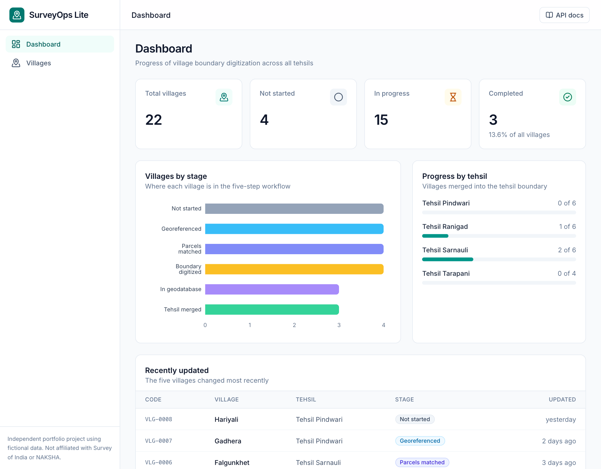
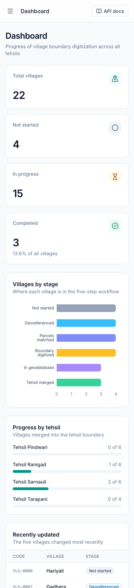
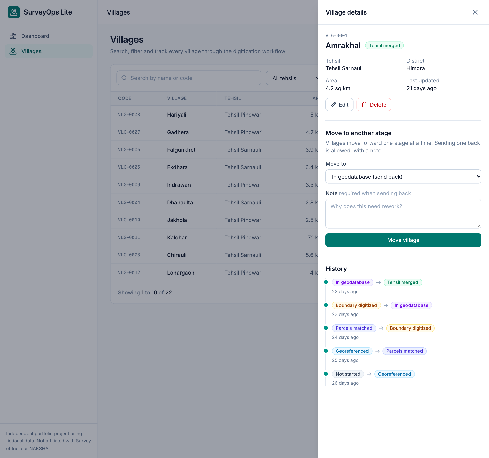
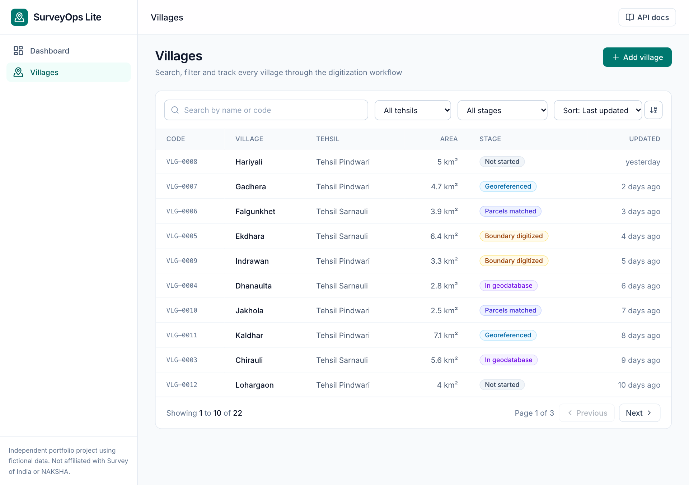
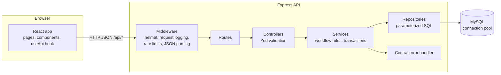
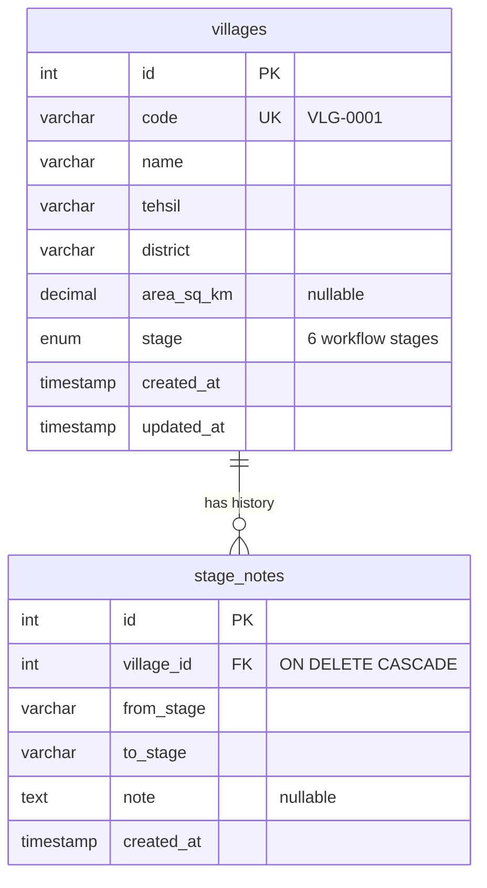

# SurveyOps Lite

**A lightweight boundary digitization tracker: follow every village through a five-step mapping workflow, with a full history of every stage change.**



> **Independent portfolio project.** SurveyOps Lite is inspired by the geospatial workflow I was exposed to during a one-month internship (July 2025) at the Survey of India, Uttarakhand Geo-Spatial Data Centre. It is **not** an official Survey of India or NAKSHA application, was not commissioned by, submitted to, or approved by either, and is not used by them. **All villages, tehsils, districts and records are fictional sample data.**

## What it does

During my internship I worked through a repeating pipeline for village boundaries: georeference the old revenue map, match land parcels against imagery, digitize the boundary, store it in a geodatabase, and finally merge villages into a tehsil boundary. This app tracks that pipeline.

- **Dashboard.** Totals, a per-stage chart, progress per tehsil and recently updated villages, all computed by SQL queries on each request.
- **Villages.** Search by name or code, filter by tehsil and stage, sort, and paginate. The URL holds the filters, so a view can be bookmarked and the Back button works.
- **Workflow rules.** A village moves forward **one stage at a time**. Sending it back for rework is allowed, but **requires a note**. The server enforces this; the UI only offers valid moves.
- **History.** Every stage change is saved with its note and time, shown as a timeline in a side panel.
- **Create, edit and delete** villages, with validation errors shown in the form.
- **API documentation** with Swagger UI at `/api/docs`.

| On a phone | Village detail panel, with stage history |
|---|---|
|  |  |



## Tech stack

| Layer | Technology |
|---|---|
| Frontend | React 19, TypeScript, Vite, Tailwind CSS 4, React Router, Axios, Recharts, Lucide icons |
| Backend | Node.js, Express 5, TypeScript, Zod (validation), pino (logging), helmet, express-rate-limit |
| Database | MySQL, `mysql2` with a connection pool and parameterized queries, versioned SQL migrations |
| API docs | OpenAPI 3.0 file served with Swagger UI |
| Tests | Vitest and Supertest (backend) |

It is a plain modular monolith: one Express service, one MySQL database. In production Express also serves the built React app, so the whole project runs as a single service.

## Architecture



A request travels **React component → Axios → middleware → route → validation → service → repository → MySQL** and back as JSON. Each layer has one job: controllers translate HTTP, services hold rules and transactions, repositories hold SQL.

## Database



- `villages.stage` is an `ENUM` of `not_started`, `georeferenced`, `parcels_matched`, `boundary_digitized`, `stored_in_geodatabase`, `tehsil_merged`.
- Indexes on `stage`, `tehsil`, `name` and `updated_at` back the filters, search and "recent" list. `code` has a unique index. `stage_notes` is indexed on `(village_id, created_at)`.
- The foreign key prevents history rows for villages that do not exist, and `ON DELETE CASCADE` removes a village's history with it.
- The schema lives in versioned files in `backend/migrations/` and is applied by a small runner that records applied files in a `schema_migrations` table.

## API

Full interactive documentation: **`/api/docs`** (raw OpenAPI file: `/api/openapi.json`).

| Method and path | Purpose |
|---|---|
| `GET /api/health` | API and database status |
| `GET /api/dashboard/stats` | Totals, counts per stage and tehsil, recent villages |
| `GET /api/villages` | List with `search`, `tehsil`, `district`, `stage`, `sort`, `order`, `page`, `pageSize` |
| `GET /api/villages/filter-options` | Tehsil and district names for dropdowns |
| `GET /api/villages/:id` | One village with its stage history |
| `POST /api/villages` | Create (code is generated, starts at `not_started`) |
| `PATCH /api/villages/:id` | Edit name, tehsil, district or area (not the stage) |
| `PATCH /api/villages/:id/stage` | Move to another stage, with an optional or required note |
| `DELETE /api/villages/:id` | Delete a village and its history |

Every error has the same shape, for example a rule violation (`422`):

```json
{ "error": { "code": "INVALID_TRANSITION", "message": "Cannot skip from \"not_started\" to \"parcels_matched\". The next stage is \"georeferenced\"" } }
```

Status codes used: `200`, `201`, `204`, `400` (validation), `404`, `422` (workflow rule), `429` (rate limit), `500`, `503` (database down).

## Design decisions worth knowing

- **Parameterized queries everywhere.** Values never become part of the SQL text. Column names cannot be parameters, so `ORDER BY` and `UPDATE` use fixed allow-lists; a sort value like `name;DROP TABLE villages` is rejected with a `400` before it reaches SQL.
- **Stage moves are transactional and locked.** Changing a stage updates `villages` and inserts into `stage_notes`. Both happen in one transaction that starts with `SELECT ... FOR UPDATE` on the village row. A test sends two identical moves at the same moment and asserts that exactly one succeeds and exactly one history row is written.
- **Validation at the edge, rules in the service.** Zod validates input shapes (and rejects unknown fields, so `PATCH` cannot sneak in a stage change); the workflow rules are one small, separately unit-tested function.
- **Rate limiting.** A general per-IP limit plus a stricter one for requests that change data. Counters are kept in memory, which is correct for one instance; several instances would need a shared store. The limits are sensible defaults that I chose, not values tuned from load testing.
- **State in the URL.** Search, filters, sort, page and the open village are query parameters, which makes views shareable and the Back button natural.

## Getting started

**Prerequisites:** Node.js, npm, and a running MySQL server. I developed and tested everything on Node 26 and MySQL 26.7 (installed with Homebrew) on macOS; other versions will probably work but I have not tried them.

```bash
git clone <this repository>
cd surveyops-lite
```

**1. Create the databases** (one for development, one for tests):

```bash
mysql -u root -p -e "
  CREATE DATABASE surveyops      CHARACTER SET utf8mb4 COLLATE utf8mb4_0900_ai_ci;
  CREATE DATABASE surveyops_test CHARACTER SET utf8mb4 COLLATE utf8mb4_0900_ai_ci;
  CREATE USER 'surveyops'@'localhost' IDENTIFIED BY 'choose-a-password';
  GRANT ALL ON surveyops.*      TO 'surveyops'@'localhost';
  GRANT ALL ON surveyops_test.* TO 'surveyops'@'localhost';"
```

**2. Configure and start the API:**

```bash
cd backend
cp .env.example .env          # then edit .env: set DB_PASSWORD to the password you chose
npm install
npm run migrate               # creates the tables
npm run seed                  # inserts 22 fictional villages with history
npm run dev                   # API on http://localhost:4001
```

**3. Start the frontend** (second terminal):

```bash
cd frontend
npm install
npm run dev                   # prints the address, usually http://localhost:5173
```

The Vite dev server forwards `/api` to `http://localhost:4001` (see `frontend/vite.config.ts`). API docs are at `http://localhost:4001/api/docs/`.

**Run the tests** (needs the `surveyops_test` database above):

```bash
cd backend
npm test
```

## Testing

**49 backend tests** in 5 files, run against a separate `surveyops_test` database. A guard in the test helpers refuses to delete data from any other database.

- Unit tests for the stage-transition rules, the `DATABASE_URL` parser and the rate limiter.
- API tests (Supertest) for every endpoint: success paths, validation errors, 404s, pagination, search and filters, the SQL-injection attempts, cascade deletes, and the concurrent stage-move race.

**Not covered:** there are no automated frontend tests yet. The frontend was checked by hand in a browser (desktop and phone widths, error and empty states, and the full create, edit, move and delete flow) and is covered by TypeScript type-checking and linting. I have not measured test coverage, so I make no coverage claim.

## Project structure

```
surveyops-lite/
├── backend/
│   ├── migrations/            versioned SQL schema files
│   ├── openapi.yaml           API description (served as Swagger UI)
│   ├── src/
│   │   ├── app.ts             middleware and routes (importable by tests)
│   │   ├── server.ts          starts listening, graceful shutdown
│   │   ├── config/            environment validation, logger
│   │   ├── db/                pool, migrator, seed, transaction helper
│   │   ├── middleware/        error handler, rate limiting
│   │   └── modules/           villages/ and dashboard/ (routes, controller, service, repository, schema)
│   └── tests/
├── frontend/
│   └── src/
│       ├── api/               typed API functions
│       ├── components/        reusable UI (dialog, toast, forms, badges, pagination)
│       ├── hooks/             useApi (loading, error, reload), useToast
│       ├── layouts/           sidebar and top bar
│       ├── pages/             Dashboard, Villages
│       └── lib/ types/        stage colours, formatting, shared types
└── docs/screenshots/
```

## Deployment

The app is built to run as one service plus one MySQL database. In production:

```bash
# build
npm ci --prefix frontend && npm run build --prefix frontend
npm ci --prefix backend  && npm run build --prefix backend

# run: applies pending migrations, then starts the server
npm run start:prod --prefix backend
```

Environment variables for production (all listed in `backend/.env.example`): `NODE_ENV=production`, `SERVE_FRONTEND=true`, `TRUST_PROXY=1`, `DB_SSL=true`, and either `DATABASE_URL` or the `DB_*` values. The seed script refuses to run in production unless `ALLOW_SEED=true` is set, because it deletes all villages.

## Known limitations and future enhancements

**Not implemented yet:**

- **Authentication and roles.** There are no users: anyone who can reach the app can edit or delete. Rate limiting is the only protection, which is acceptable for a demo of fictional data and not for real records.
- **A general audit log.** Stage changes are recorded with notes, but creating, editing and deleting villages are not logged.
- **Review assignment** (reviewers, priorities, a review queue).
- **Map view** (Leaflet with sample GeoJSON polygons).
- **Frontend automated tests** and continuous integration.

**Out of scope on purpose:** real georeferencing, imagery processing and automated boundary matching. This app tracks the workflow; it does not perform GIS analysis.

**Small known rough edges:** some validation messages use the validation library's technical wording (for example "Too small: expected string to have >=1 characters"), and the production JavaScript bundle is about 735 kB (226 kB compressed), mostly the chart library.
